# Práctica de redes: VLSM, ACL, DHCP, Wi-Fi, DNS y servidores web

Proyecto de Cisco Packet Tracer con cinco redes interconectadas mediante routers, una de ellas dividida con VLSM y aislada con ACL, más una red de servidores con DNS y tres páginas web.

**Autor:** Pablo Carmona Rodríguez
**Módulo:** Redes / Sistemas Informáticos
**Herramienta:** Cisco Packet Tracer
**Archivo del proyecto:** `Ejercicio2.pkt`

---

## Índice

1. [Objetivo](#1-objetivo)
2. [Topología general](#2-topología-general)
3. [Plan de direccionamiento](#3-plan-de-direccionamiento)
4. [Cálculo VLSM de la Red 1](#4-cálculo-vlsm-de-la-red-1)
5. [Configuración de los routers y enrutamiento](#5-configuración-de-los-routers-y-enrutamiento)
6. [Red 1: VLANs y ACL](#6-red-1-vlans-y-acl)
7. [DHCP](#7-dhcp)
8. [Red 4: Wi-Fi](#8-red-4-wi-fi)
9. [DNS y servidores web](#9-dns-y-servidores-web)
10. [Pruebas de funcionamiento](#10-pruebas-de-funcionamiento)
11. [Problemas encontrados y soluciones](#11-problemas-encontrados-y-soluciones)
12. [Estructura del repositorio](#12-estructura-del-repositorio)

---

## 1. Objetivo

Diseñar e implementar en Packet Tracer una red formada por cinco redes más una red de servidores, interconectadas mediante routers, cumpliendo estos requisitos:

- **Red 1:** una red dividida con VLSM en tres subredes (100, 30 y 6 equipos), con 4 PCs por subred e IP estática. Las tres subredes deben estar aisladas entre sí y del resto de redes.
- **Red 2:** 8 PCs con DHCP.
- **Red 3:** 4 PCs con DHCP, con un rango distinto al de la Red 2.
- **Red 4:** 4 PCs cableados con IP fija y 5 portátiles por Wi-Fi con DHCP, con seguridad WPA2-PSK.
- **Red 5:** 5 PCs con IP estática.
- **Servidores:** un servidor DNS y tres servidores web (`www.albacete.es`, `www.wagner.de` y `www.dilar.com`), cada uno con su fotografía.
- **Seguridad:** ACL que impiden cualquier comunicación de la Red 1 con el resto y entre sus propias subredes.

## 2. Topología general

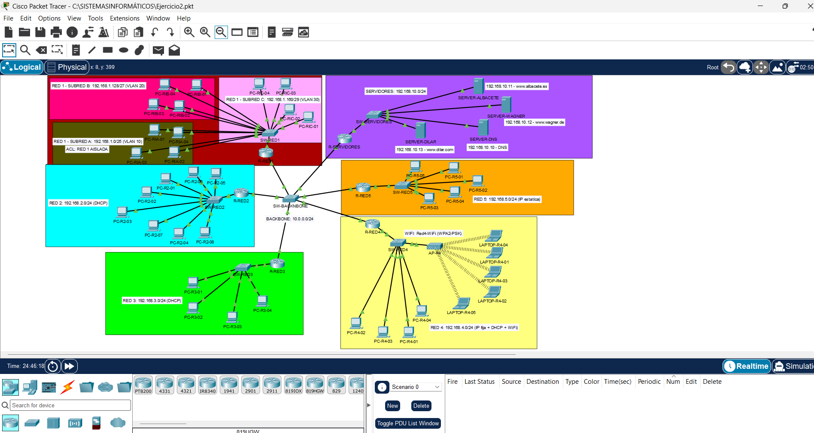

**Dispositivos utilizados:**

| Tipo | Modelo | Cantidad | Nombres |
|---|---|---|---|
| Routers | Cisco 2911 | 6 | R-Red1, R-Red2, R-Red3, R-Red4, R-Red5, R-Servidores |
| Switches | Cisco 2960-24TT | 7 | SW-Backbone, SW-Red1, SW-Red2, SW-Red3, SW-Red4, SW-Red5, SW-Servidores |
| PCs | PC | 33 | PC-R1A-01 a 04, PC-R1B-01 a 04, PC-R1C-01 a 04, PC-R2-01 a 08, PC-R3-01 a 04, PC-R4-01 a 04, PC-R5-01 a 05 |
| Portátiles | Laptop con módulo WPC300N | 5 | LAPTOP-R4-01 a 05 |
| Punto de acceso | Access-Point-PT | 1 | AP-R4 |
| Servidores | Server | 4 | SRV-DNS, SRV-ALBACETE, SRV-WAGNER, SRV-DILAR |

**Organización de la red:**

Cada red tiene su propio router. Los seis routers se conectan entre sí mediante un switch central (`SW-Backbone`) que forma la red de backbone `10.0.0.0/24`. De este modo cada router solo necesita dos interfaces: `Gi0/0` hacia el backbone y `Gi0/1` hacia su red local.

| Router | Gi0/0 (backbone) | Gi0/1 (LAN) |
|---|---|---|
| R-Red1 | 10.0.0.1/24 | Trunk con subinterfaces .10, .20 y .30 |
| R-Red2 | 10.0.0.2/24 | 192.168.2.1/24 |
| R-Red3 | 10.0.0.3/24 | 192.168.3.1/24 |
| R-Red4 | 10.0.0.4/24 | 192.168.4.1/24 |
| R-Red5 | 10.0.0.5/24 | 192.168.5.1/24 |
| R-Servidores | 10.0.0.6/24 | 192.168.10.1/24 |

Todos los cables son de tipo directo (*straight-through*). Cada router se conecta con `Gi0/0` a un puerto de `SW-Backbone` (Fa0/1 a Fa0/6, por orden) y con `Gi0/1` al puerto `Fa0/1` del switch de su red.

## 3. Plan de direccionamiento

| Red | Dirección de red | Máscara | Gateway | Equipos | Asignación |
|---|---|---|---|---|---|
| Red 1, subred A | 192.168.1.0/25 | 255.255.255.128 | 192.168.1.1 | 4 PCs | IP estática |
| Red 1, subred B | 192.168.1.128/27 | 255.255.255.224 | 192.168.1.129 | 4 PCs | IP estática |
| Red 1, subred C | 192.168.1.160/29 | 255.255.255.248 | 192.168.1.161 | 4 PCs | IP estática |
| Red 2 | 192.168.2.0/24 | 255.255.255.0 | 192.168.2.1 | 8 PCs | DHCP |
| Red 3 | 192.168.3.0/24 | 255.255.255.0 | 192.168.3.1 | 4 PCs | DHCP |
| Red 4 | 192.168.4.0/24 | 255.255.255.0 | 192.168.4.1 | 4 PCs + 5 portátiles | IP fija (PCs) y DHCP (portátiles) |
| Red 5 | 192.168.5.0/24 | 255.255.255.0 | 192.168.5.1 | 5 PCs | IP estática |
| Servidores | 192.168.10.0/24 | 255.255.255.0 | 192.168.10.1 | 4 servidores | IP estática |
| Backbone | 10.0.0.0/24 | 255.255.255.0 | — | 6 routers | IP estática |

**Direcciones fijas de los equipos:**

| Equipo | IP | Máscara | Gateway | DNS |
|---|---|---|---|---|
| PC-R1A-01 a 04 | 192.168.1.2 a 192.168.1.5 | 255.255.255.128 | 192.168.1.1 | — |
| PC-R1B-01 a 04 | 192.168.1.130 a 192.168.1.133 | 255.255.255.224 | 192.168.1.129 | — |
| PC-R1C-01 a 04 | 192.168.1.162 a 192.168.1.165 | 255.255.255.248 | 192.168.1.161 | — |
| PC-R4-01 a 04 | 192.168.4.11 a 192.168.4.14 | 255.255.255.0 | 192.168.4.1 | 192.168.10.10 |
| PC-R5-01 a 05 | 192.168.5.11 a 192.168.5.15 | 255.255.255.0 | 192.168.5.1 | 192.168.10.10 |
| SRV-DNS | 192.168.10.10 | 255.255.255.0 | 192.168.10.1 | 192.168.10.10 |
| SRV-ALBACETE | 192.168.10.11 | 255.255.255.0 | 192.168.10.1 | 192.168.10.10 |
| SRV-WAGNER | 192.168.10.12 | 255.255.255.0 | 192.168.10.1 | 192.168.10.10 |
| SRV-DILAR | 192.168.10.13 | 255.255.255.0 | 192.168.10.1 | 192.168.10.10 |

Captura de la configuración de un PC de cada subred de la Red 1:

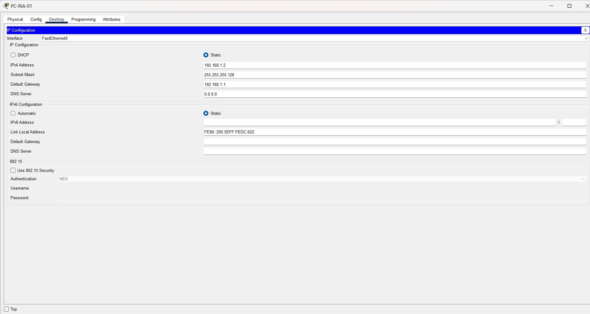
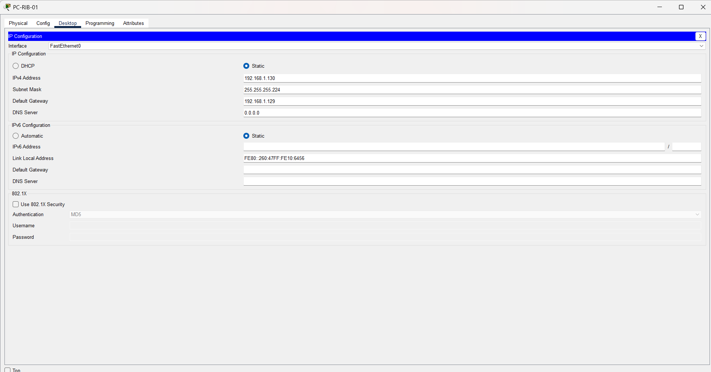
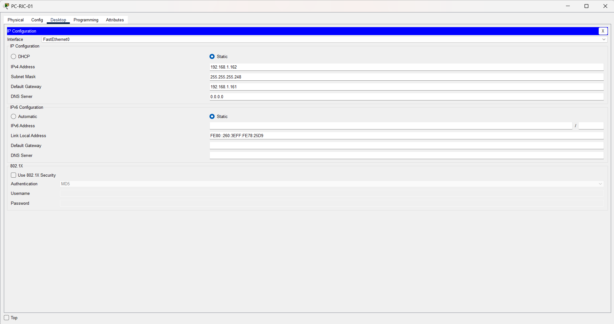

Ejemplos de equipos con IP estática en otras redes:

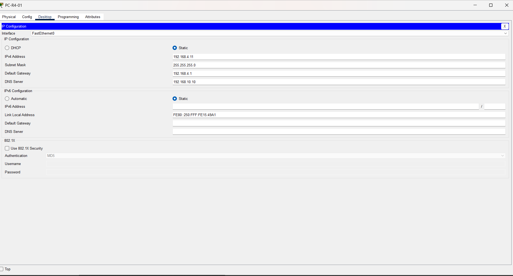
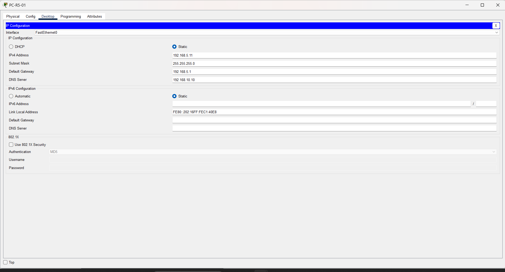
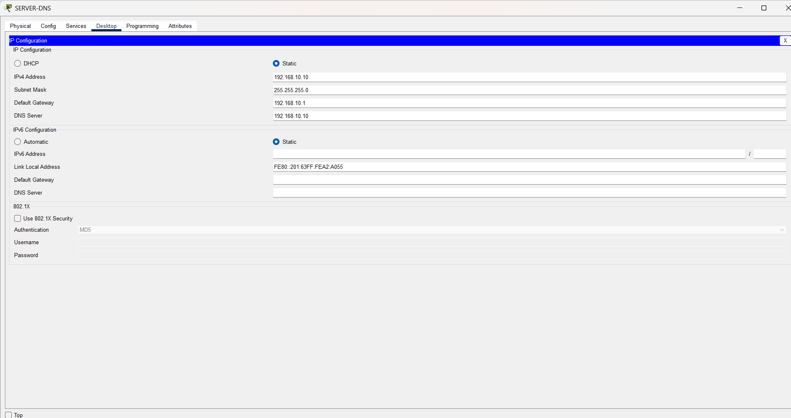

## 4. Cálculo VLSM de la Red 1

Se parte de la red `192.168.1.0/24` y se reparte de la subred más grande a la más pequeña, para evitar solapamientos y desperdiciar el mínimo de direcciones.

**Paso 1: tamaño de cada subred.** Con `n` bits de host hay `2^n - 2` direcciones utilizables.

| Subred | Hosts necesarios | Bits de host | Direcciones útiles | Prefijo | Máscara |
|---|---|---|---|---|---|
| A | 100 | 7 (2^7 - 2 = 126) | 126 | /25 | 255.255.255.128 |
| B | 30 | 5 (2^5 - 2 = 30) | 30 | /27 | 255.255.255.224 |
| C | 6 | 3 (2^3 - 2 = 6) | 6 | /29 | 255.255.255.248 |

**Paso 2: asignación ordenada.**

| Subred | Dirección de red | Primer host | Último host | Broadcast |
|---|---|---|---|---|
| A | 192.168.1.0/25 | 192.168.1.1 | 192.168.1.126 | 192.168.1.127 |
| B | 192.168.1.128/27 | 192.168.1.129 | 192.168.1.158 | 192.168.1.159 |
| C | 192.168.1.160/29 | 192.168.1.161 | 192.168.1.166 | 192.168.1.167 |

Las direcciones de 192.168.1.168 a 192.168.1.255 quedan libres para futuras ampliaciones. La puerta de enlace de cada subred es la primera dirección útil (la del router).

## 5. Configuración de los routers y enrutamiento

Se utiliza **RIP versión 2** con la sumarización automática desactivada (`no auto-summary`), para que cada router anuncie exactamente sus redes y aprenda las de los demás.

**Ejemplo: R-Red2**

```
enable
configure terminal
hostname R-Red2
no ip domain-lookup
interface GigabitEthernet0/0
 description Backbone
 ip address 10.0.0.2 255.255.255.0
 no shutdown
 exit
interface GigabitEthernet0/1
 description LAN Red 2
 ip address 192.168.2.1 255.255.255.0
 no shutdown
 exit
router rip
 version 2
 no auto-summary
 network 10.0.0.0
 network 192.168.2.0
 exit
end
write memory
```

Los routers `R-Red3`, `R-Red4`, `R-Red5` y `R-Servidores` siguen el mismo esquema, con sus IPs del backbone (`10.0.0.3` a `10.0.0.6`) y de su LAN.

**R-Red1 (con subinterfaces):**

```
enable
configure terminal
hostname R-Red1
no ip domain-lookup
interface GigabitEthernet0/0
 description Backbone
 ip address 10.0.0.1 255.255.255.0
 no shutdown
 exit
interface GigabitEthernet0/1
 description Trunk a SW-Red1
 no ip address
 no shutdown
 exit
interface GigabitEthernet0/1.10
 description Red 1 Subred A
 encapsulation dot1Q 10
 ip address 192.168.1.1 255.255.255.128
 exit
interface GigabitEthernet0/1.20
 description Red 1 Subred B
 encapsulation dot1Q 20
 ip address 192.168.1.129 255.255.255.224
 exit
interface GigabitEthernet0/1.30
 description Red 1 Subred C
 encapsulation dot1Q 30
 ip address 192.168.1.161 255.255.255.248
 exit
router rip
 version 2
 no auto-summary
 network 10.0.0.0
 exit
end
write memory
```

**Importante:** `R-Red1` solo anuncia por RIP la red `10.0.0.0` y no las redes `192.168.1.x`. De este modo el resto de routers no aprenden ninguna ruta hacia la Red 1, que es una primera barrera de aislamiento. Las ACL (apartado 6) son la segunda.

**Tabla de rutas de R-Red2:** aparecen aprendidas por RIP las redes 192.168.3.0/24, 192.168.4.0/24, 192.168.5.0/24 y 192.168.10.0/24, y **no** aparece la 192.168.1.0.

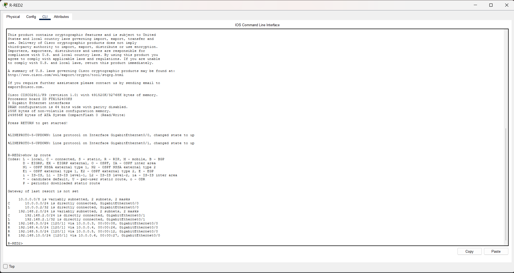

Estado de las interfaces de `R-Red1`, con las tres subinterfaces activas:

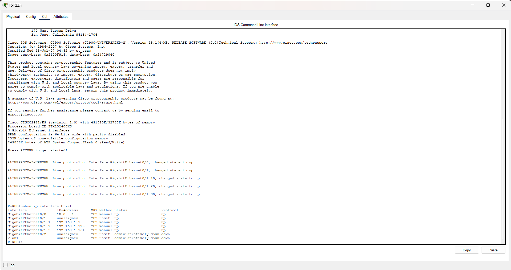

## 6. Red 1: VLANs y ACL

### 6.1 VLANs en SW-Red1

Las tres subredes comparten el mismo switch, pero se separan en VLANs. El puerto `Fa0/1` es un trunk hacia el router (*router-on-a-stick*) y el resto se reparte por VLAN:

| VLAN | Nombre | Puertos | Subred |
|---|---|---|---|
| 10 | Subred-A | Fa0/2 a Fa0/5 | 192.168.1.0/25 |
| 20 | Subred-B | Fa0/6 a Fa0/9 | 192.168.1.128/27 |
| 30 | Subred-C | Fa0/10 a Fa0/13 | 192.168.1.160/29 |

```
enable
configure terminal
hostname SW-Red1
no ip domain-lookup
vlan 10
 name Subred-A
 exit
vlan 20
 name Subred-B
 exit
vlan 30
 name Subred-C
 exit
interface FastEthernet0/1
 description Trunk a R-Red1
 switchport mode trunk
 exit
interface range FastEthernet0/2 - 5
 switchport mode access
 switchport access vlan 10
 exit
interface range FastEthernet0/6 - 9
 switchport mode access
 switchport access vlan 20
 exit
interface range FastEthernet0/10 - 13
 switchport mode access
 switchport access vlan 30
 exit
end
write memory
```

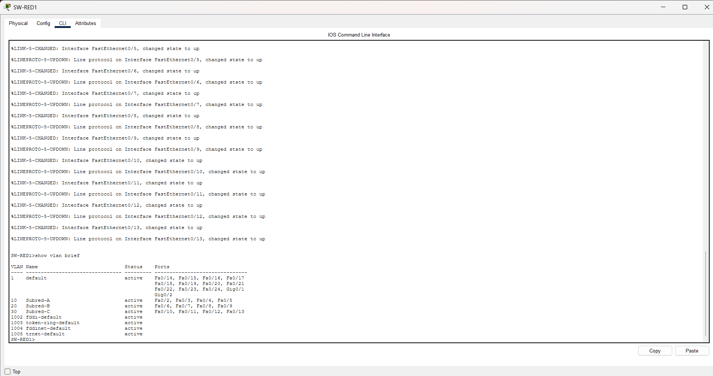

### 6.2 Problema: las subredes se ven entre sí

Con las VLANs y las subinterfaces, el router comunica por defecto las tres subredes. Antes de aplicar las ACL, un PC de la subred A podía hacer ping a un PC de la subred B, lo que incumplía el requisito de aislamiento.

### 6.3 ACL aplicadas en R-Red1

Se utilizan dos ACL extendidas con nombre:

```
ip access-list extended BLOQUEO-SALIDA-RED1
 deny ip 192.168.1.0 0.0.0.255 any
 permit ip any any
 exit
ip access-list extended BLOQUEO-ENTRADA-RED1
 deny ip any 192.168.1.0 0.0.0.255
 permit ip any any
 exit
interface GigabitEthernet0/1.10
 ip access-group BLOQUEO-SALIDA-RED1 in
 exit
interface GigabitEthernet0/1.20
 ip access-group BLOQUEO-SALIDA-RED1 in
 exit
interface GigabitEthernet0/1.30
 ip access-group BLOQUEO-SALIDA-RED1 in
 exit
interface GigabitEthernet0/0
 ip access-group BLOQUEO-ENTRADA-RED1 in
 exit
```

**Explicación:**

- `BLOQUEO-SALIDA-RED1` se aplica en sentido de entrada (`in`) en las tres subinterfaces. Bloquea todo el tráfico que origina un equipo de la Red 1 hacia cualquier destino fuera de su propia subred, tanto hacia las otras subredes de la Red 1 como hacia las demás redes.
- `BLOQUEO-ENTRADA-RED1` se aplica en sentido de entrada en `Gi0/0` (backbone). Bloquea todo el tráfico que llega desde el resto de la red con destino a la Red 1.
- La máscara `0.0.0.255` es una máscara *wildcard* que abarca los 256 valores de `192.168.1.0/24`, es decir, las tres subredes A, B y C.
- La instrucción `permit ip any any` final es necesaria porque toda ACL tiene un `deny` implícito al final.
- Los equipos de una misma subred siguen comunicándose entre sí, porque ese tráfico se conmuta dentro de la VLAN y no pasa por el router.

Configuración de las ACL:

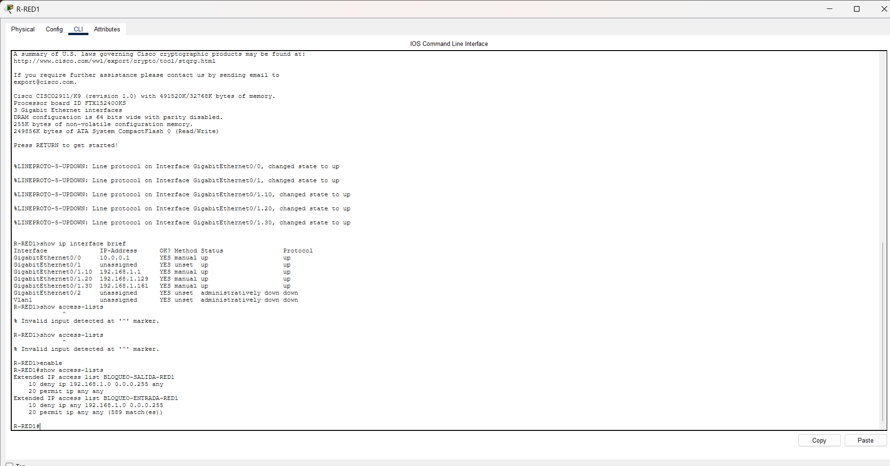

### 6.4 Comprobación de las ACL

| Prueba | Resultado esperado | Captura |
|---|---|---|
| Ping entre dos PCs de la misma subred | Responde | 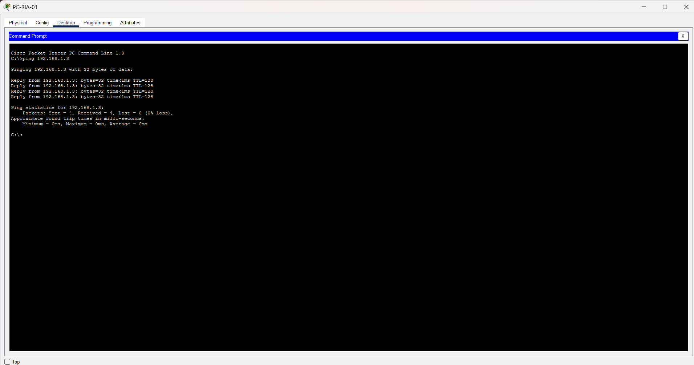 |
| Ping a un PC de otra subred de la Red 1 | Bloqueado | 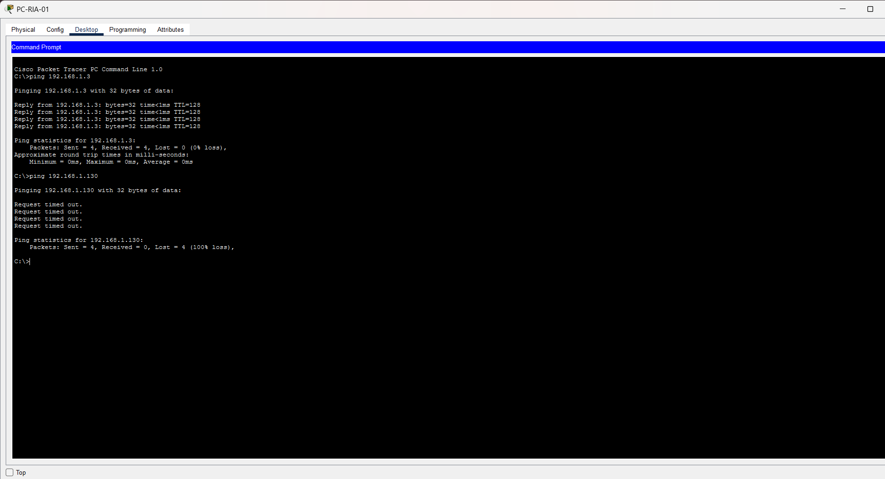 |
| Ping desde la Red 1 a la Red 2 | Bloqueado | 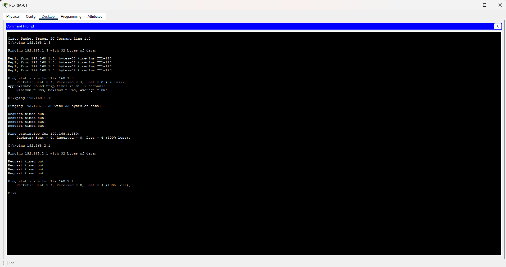 |
| Ping desde la Red 2 a la Red 1 | Bloqueado | 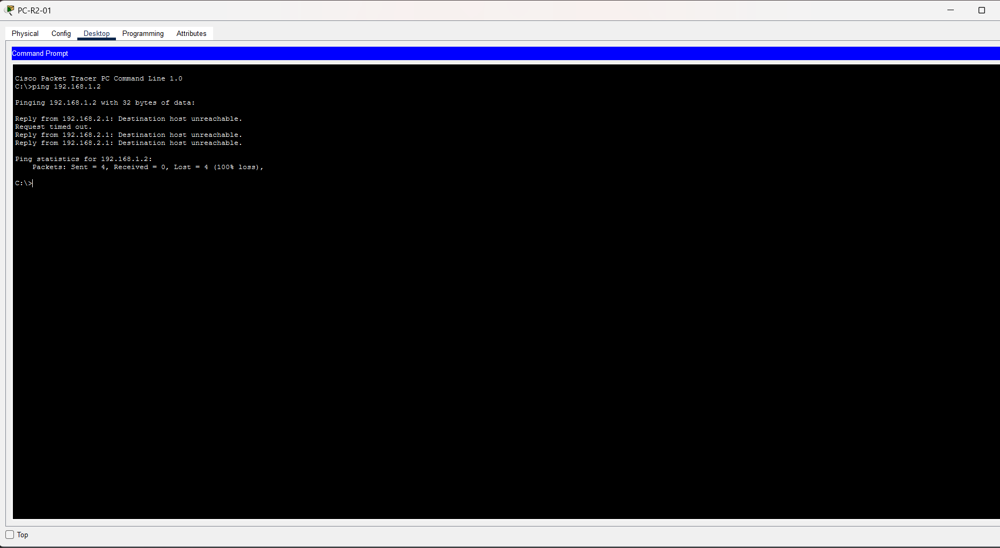 |

Los contadores de coincidencias (`matches`) de las líneas `deny` aumentan con cada ping bloqueado, lo que demuestra que las ACL están actuando:

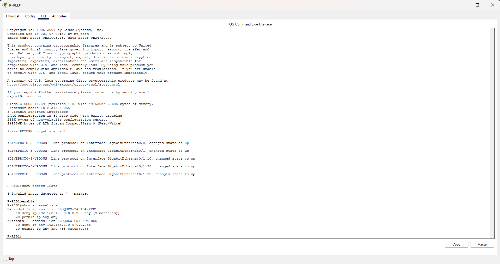

**Nota sobre el sentido del bloqueo:** el tráfico procedente de la Red 2 hacia la Red 1 se detiene ya en `R-Red2`, porque no existe ninguna ruta hacia `192.168.1.0/24` (la Red 1 no se anuncia en RIP). La ACL `BLOQUEO-ENTRADA-RED1` es una segunda protección que seguiría bloqueando ese tráfico aunque en algún momento se añadiera una ruta hacia la Red 1.

## 7. DHCP

El servicio DHCP lo ofrece cada router en su propia red, mediante un pool. Todos reparten como servidor DNS la dirección `192.168.10.10`.

| Red | Router | Direcciones excluidas | Pool | Rango repartido |
|---|---|---|---|---|
| Red 2 | R-Red2 | 192.168.2.1 a 192.168.2.9 | RED2 | 192.168.2.10 en adelante |
| Red 3 | R-Red3 | 192.168.3.1 a 192.168.3.49 | RED3 | 192.168.3.50 en adelante |
| Red 4 | R-Red4 | 192.168.4.1 a 192.168.4.99 | RED4 | 192.168.4.100 en adelante |

La Red 3 usa un rango diferente al de la Red 2, como exige el enunciado. En la Red 4 se excluyen las 99 primeras direcciones porque los PCs cableados tienen IP fija (de la .11 a la .14) y el DHCP solo atiende a los portátiles.

**Configuración de R-Red2:**

```
ip dhcp excluded-address 192.168.2.1 192.168.2.9
ip dhcp pool RED2
 network 192.168.2.0 255.255.255.0
 default-router 192.168.2.1
 dns-server 192.168.10.10
 exit
```

**Configuración de R-Red3:**

```
ip dhcp excluded-address 192.168.3.1 192.168.3.49
ip dhcp pool RED3
 network 192.168.3.0 255.255.255.0
 default-router 192.168.3.1
 dns-server 192.168.10.10
 exit
```

**Configuración de R-Red4:**

```
ip dhcp excluded-address 192.168.4.1 192.168.4.99
ip dhcp pool RED4
 network 192.168.4.0 255.255.255.0
 default-router 192.168.4.1
 dns-server 192.168.10.10
 exit
```

Equipos que reciben IP, máscara, puerta de enlace y DNS automáticamente:

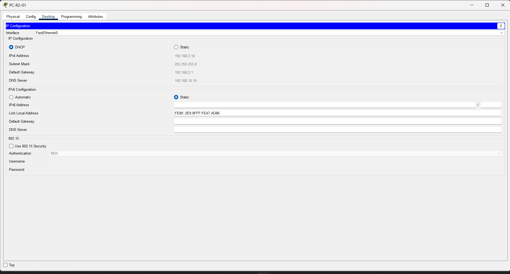
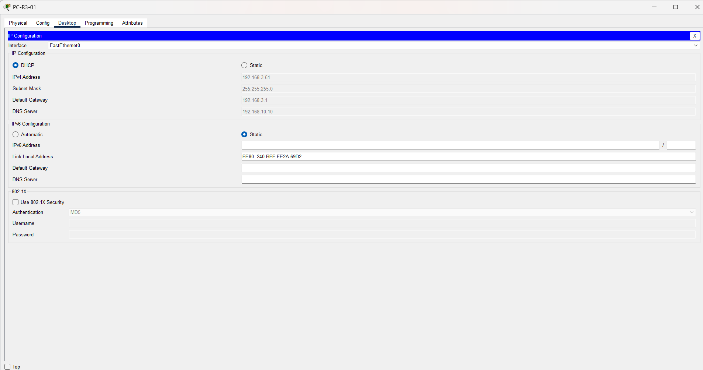
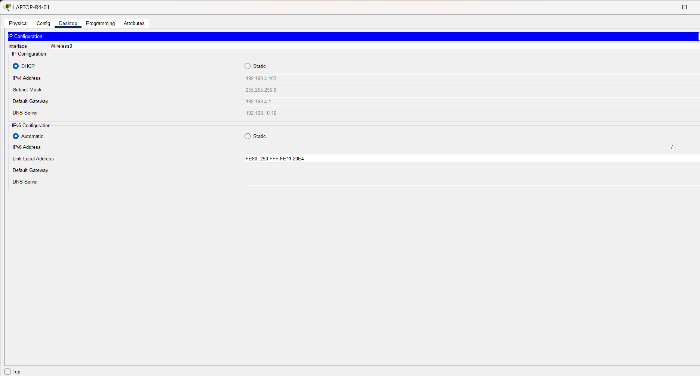

## 8. Red 4: Wi-Fi

El punto de acceso `AP-R4` está conectado por cable a `SW-Red4` (puerto `Fa0/6`) y da cobertura a cinco portátiles.

| Parámetro | Valor |
|---|---|
| SSID | Red4-WiFi |
| Autenticación | WPA2-PSK |
| Cifrado | AES |
| Clave (práctica) | redes2026 |
| Red | 192.168.4.0/24 |

Cada portátil lleva el módulo inalámbrico WPC300N en lugar del módulo Ethernet que traen por defecto, con el mismo SSID y clave, y obtiene su IP por DHCP.

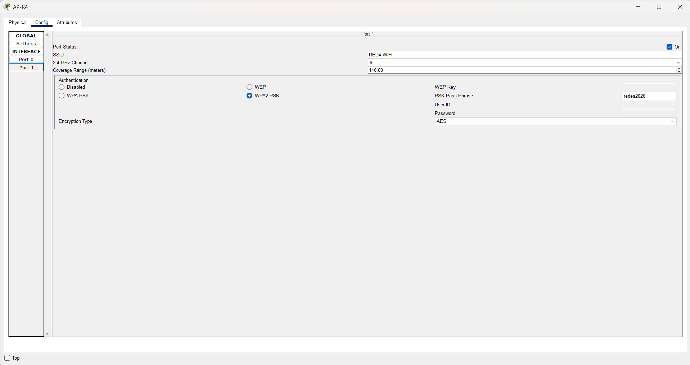
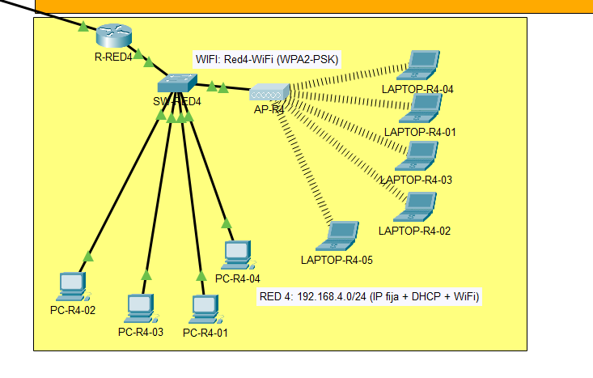

## 9. DNS y servidores web

### 9.1 Servidor DNS (SRV-DNS, 192.168.10.10)

Registros de tipo A configurados:

| Nombre | Dirección |
|---|---|
| www.albacete.es | 192.168.10.11 |
| www.wagner.de | 192.168.10.12 |
| www.dilar.com | 192.168.10.13 |

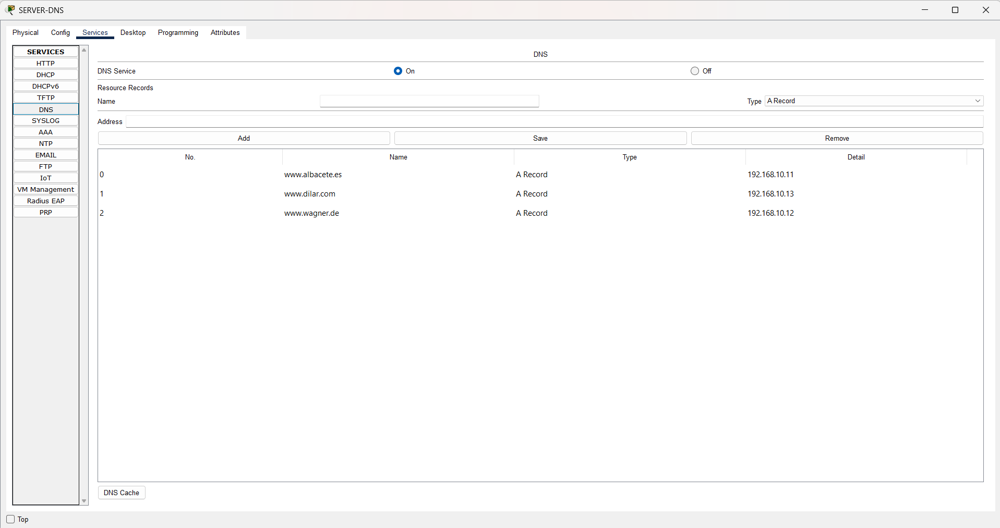

### 9.2 Servidores web

Cada servidor tiene el servicio HTTP activado y una página `index.html` con un título, una fotografía y una breve descripción. Las fotografías se subieron a cada servidor con la opción **Import** del servicio HTTP. Los archivos originales están en la carpeta `web/`.

| Servidor | IP | Dominio | Imagen |
|---|---|---|---|
| SRV-ALBACETE | 192.168.10.11 | www.albacete.es | albacete.jpg |
| SRV-WAGNER | 192.168.10.12 | www.wagner.de | wagner.jpg |
| SRV-DILAR | 192.168.10.13 | www.dilar.com | dilar.jpg |

Páginas web cargadas desde un navegador usando el nombre de dominio:

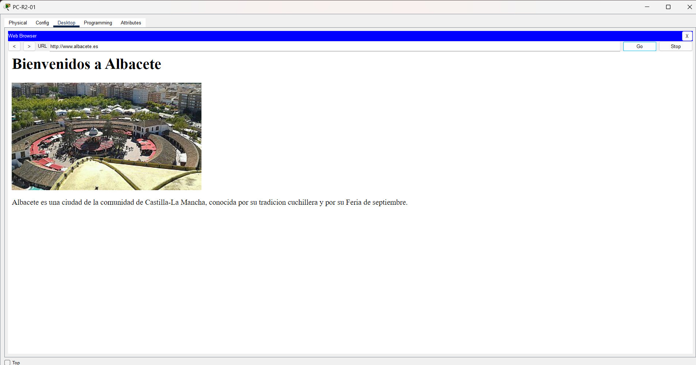

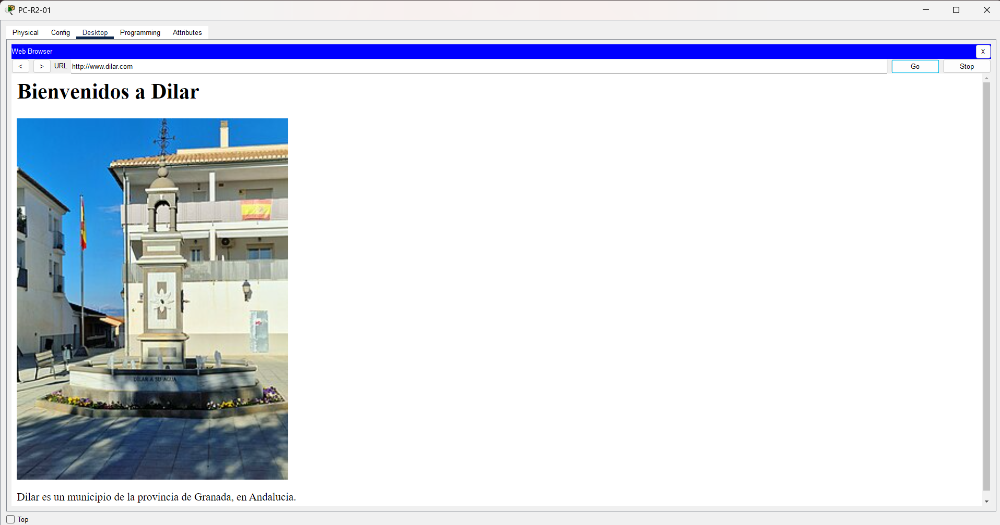

## 10. Pruebas de funcionamiento

| Prueba | Resultado esperado | Captura |
|---|---|---|
| Resolución de nombres: `ping www.albacete.es` | Se traduce a 192.168.10.11 | 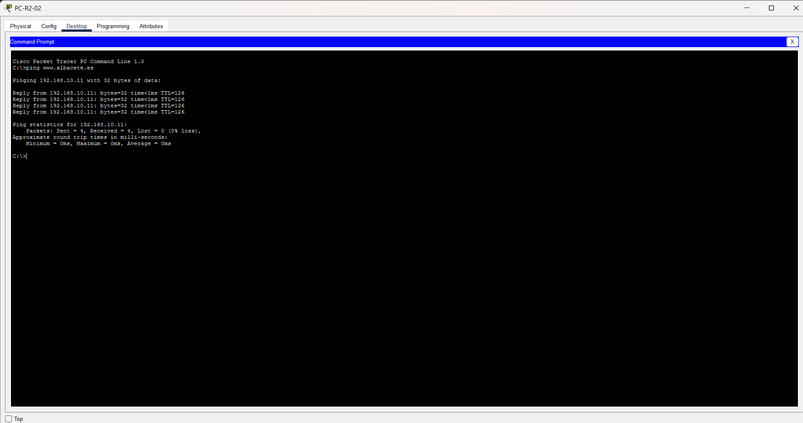 |
| Ping entre redes distintas: PC de la Red 2 a PC de la Red 5 | Responde | 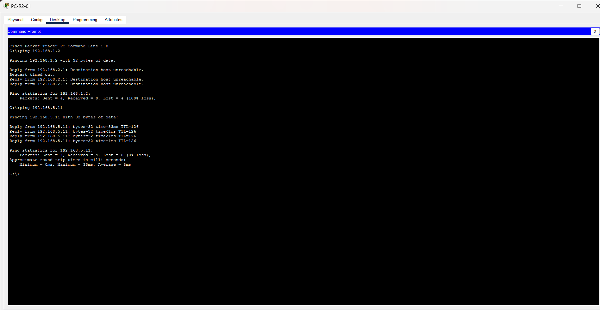 |
| Ping desde un portátil Wi-Fi a la Red 5 | Responde | 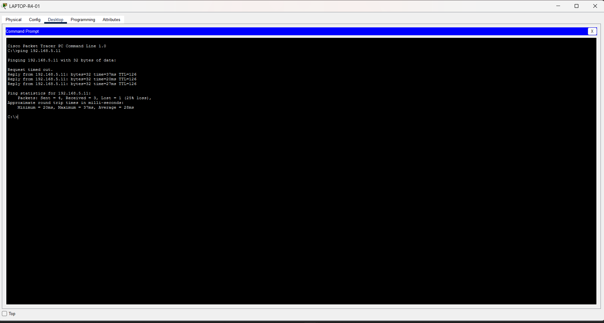 |
| Ping dentro de una subred de la Red 1 | Responde | Ver apartado 6.4 |
| Ping entre subredes de la Red 1 y hacia otras redes | Bloqueado | Ver apartado 6.4 |

Nota: el primer paquete de un ping suele perderse porque el equipo todavía está aprendiendo la dirección MAC del siguiente salto (ARP). Los siguientes responden con normalidad.

## 11. Problemas encontrados y soluciones

| Problema | Causa | Solución |
|---|---|---|
| Errores `% Invalid input detected` al configurar `SW-Red1` | Erratas al teclear (`swtichport`, `vlan10` sin espacio y un nombre de VLAN con espacio) y el switch salió del modo de configuración antes de terminar | Se repitió el bloque de comandos de los puertos, que se puede ejecutar de nuevo sin problema, y se comprobó con `show vlan brief` |
| Las subredes de la Red 1 se comunicaban entre sí | El router enruta por defecto entre sus subinterfaces | Se aplicaron las ACL `BLOQUEO-SALIDA-RED1` y `BLOQUEO-ENTRADA-RED1` |
| [Añade aquí otros problemas que hayas tenido] | | |


## 12. Estructura del repositorio

```
.
├── README.md
├── Ejercicio2.pkt
├── Imagenes/
│   ├── 01-topologia.png
│   ├── 02-ruta-rred2.png
│   └── ...
└── web/
    ├── albacete/
    │   ├── index.html
    │   └── albacete.jpg
    ├── wagner/
    │   ├── index.html
    │   └── wagner.jpg
    └── dilar/
        ├── index.html
        └── dilar.jpg
```
